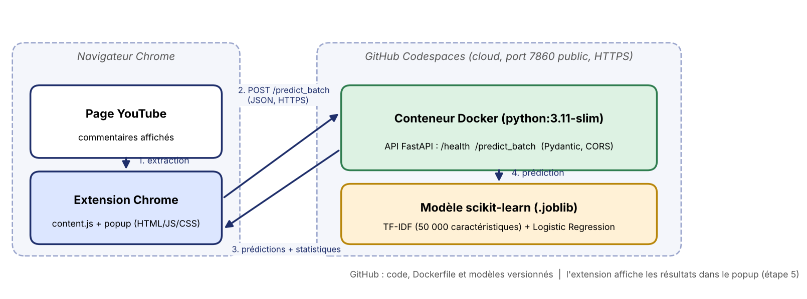
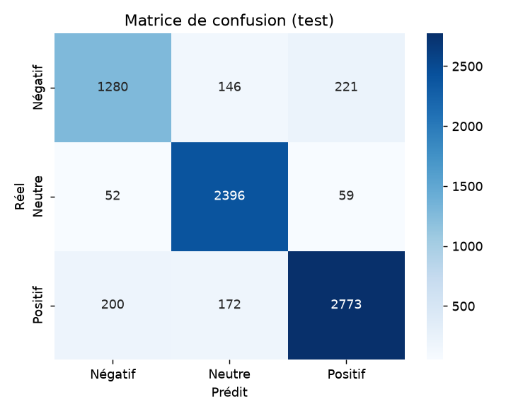
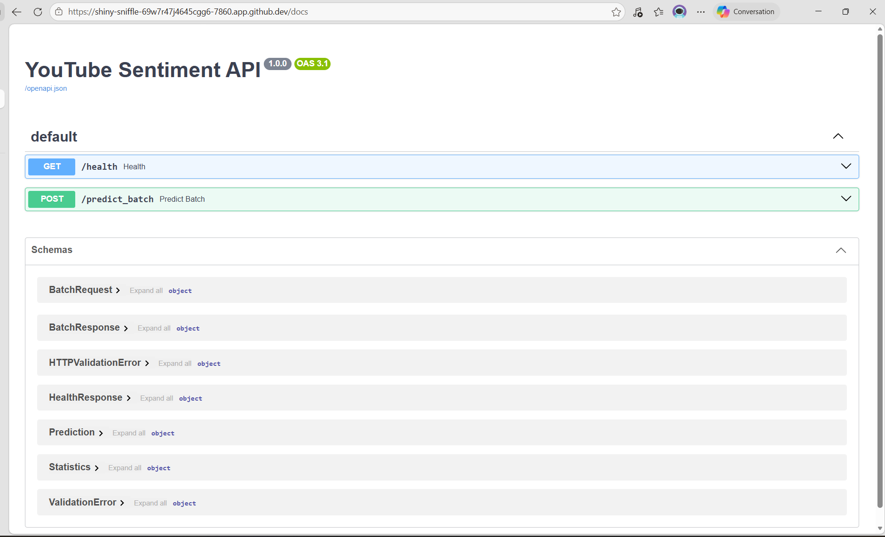
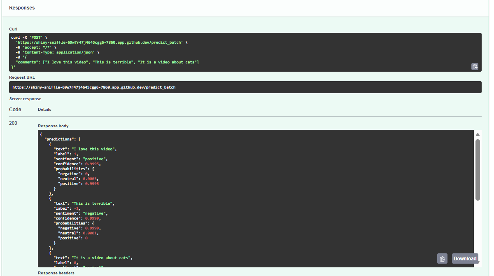
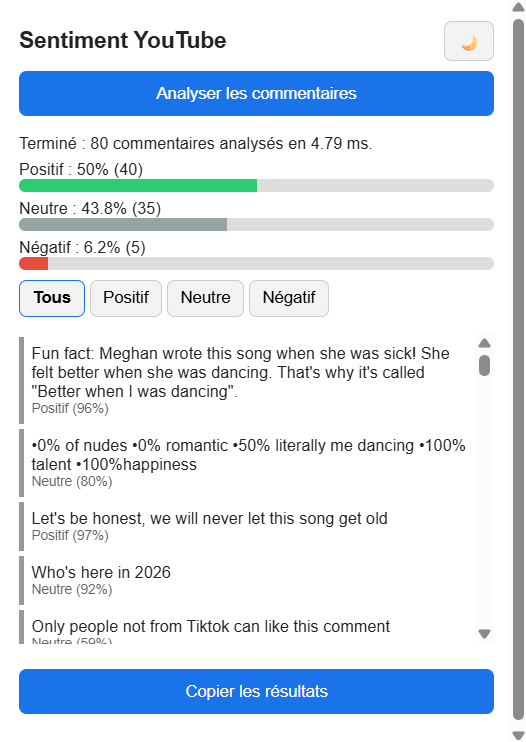
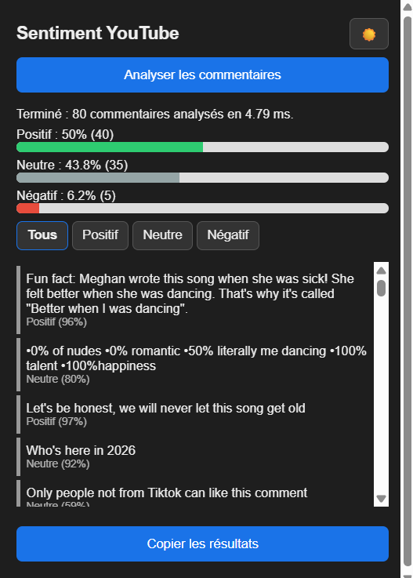

# Analyse de sentiment des commentaires YouTube

**TP3 : Projet ML complet, du développement au déploiement cloud**
ENSAM Rabat, Université Mohammed V, filière INDIA (2026/27), Prof. Maria Zemzami
Réalisé par **Wissal Elbidali**

Système MLOps qui analyse automatiquement le sentiment (négatif, neutre, positif) des commentaires d'une vidéo YouTube : un modèle scikit-learn, une API FastAPI conteneurisée avec Docker et exécutée dans GitHub Codespaces, et une extension Chrome qui affiche les résultats.

---

## 1. Description du projet

Les créateurs de contenu reçoivent des centaines de commentaires par vidéo. Les lire à la main est long, subjectif et difficile à quantifier. Cette application extrait les commentaires visibles sur la page YouTube, les envoie à une API de prédiction, puis affiche la répartition des sentiments, la liste des commentaires avec leur niveau de confiance, des filtres, un mode sombre et une fonction de copie.

## 2. Architecture technique

```
Utilisateur sur YouTube
        │
        ▼
Extension Chrome (content.js extrait les commentaires, popup.js les envoie)
        │  POST /predict_batch (JSON, HTTPS)
        ▼
API FastAPI dans un conteneur Docker (GitHub Codespaces, port 7860 public)
        │
        ▼
TF-IDF + Régression logistique (fichiers .joblib)
        │
        ▼
Prédictions + statistiques  ──►  affichage dans le popup
```

| Composant | Technologie |
|---|---|
| Frontend | Extension Chrome (Manifest V3, JavaScript, HTML, CSS) |
| Backend | API REST FastAPI + validation Pydantic + CORS |
| Modèle | scikit-learn : TF-IDF + Logistic Regression |
| Déploiement | Docker (`python:3.11-slim`) dans GitHub Codespaces |
| Versioning | Git + GitHub |
| Tests | pytest (24 tests) |



## 3. Structure du dépôt

```
youtube-sentiment/
├── app_api.py                # Point d'entrée de l'API (déploiement)
├── Dockerfile
├── .dockerignore
├── requirements.txt          # Dépendances de développement
├── requirements-prod.txt     # Dépendances de production (image Docker)
├── pytest.ini
├── data/
│   ├── raw/                  # Données brutes (reddit.csv)
│   └── processed/            # Données nettoyées et split train/test
├── models/
│   ├── sentiment_model.joblib
│   └── tfidf_vectorizer.joblib
├── src/
│   ├── data/                 # download_data.py, preprocess.py (nettoyage, EDA, split)
│   ├── models/               # baseline.py, train.py (comparaison, GridSearchCV, sauvegarde)
│   ├── api/                  # main.py (FastAPI), schemas.py (Pydantic), predictor.py
│   └── utils/                # text_cleaning.py
├── chrome-extension/         # manifest.json, content.js, popup.html, popup.css, popup.js
├── tests/                    # test_model.py, test_api.py
├── reports/                  # eda.png, confusion_matrix.png, performance_report.md
└── logs/
```

## 4. Données et modèle

- **Dataset** : Reddit Sentiment Analysis (37 249 commentaires, labels -1 négatif, 0 neutre, 1 positif), 36 493 lignes après nettoyage.
- **Nettoyage** : suppression des URLs, mentions et caractères spéciaux.
- **Split** : 80 % / 20 % (29 194 / 7 299), stratifié, `random_state=42`.
- **Algorithmes comparés** : Logistic Regression, LinearSVC, Random Forest, puis optimisation par GridSearchCV.

| Algorithme | Accuracy | F1 macro |
|---|---|---|
| Logistic Regression (défaut) | 0,849 | 0,839 |
| LinearSVC | 0,876 | 0,864 |
| Random Forest | 0,796 | 0,765 |
| **Logistic Regression optimisée (C = 50)** | **0,884** | **0,873** |

F1 par classe : négatif 0,805, neutre 0,918, positif 0,895. Temps d'inférence d'un batch de 50 commentaires : environ 2 ms.

| Critère du sujet | Objectif | Obtenu |
|---|---|---|
| Accuracy | ≥ 80 % | 88,4 % |
| F1 par classe | > 0,75 | 0,805 à 0,918 |
| Inférence (batch de 50) | < 100 ms | environ 2 ms |



## 5. Installation et exécution en local

Prérequis : Python 3.11, Git, Google Chrome.

```powershell
git clone https://github.com/Wissal-05/youtube-sentiment.git
cd youtube-sentiment
python -m venv venv
venv\Scripts\activate
pip install -r requirements.txt
```

Reproduire le pipeline (facultatif, les modèles `.joblib` sont déjà dans le dépôt) :

```powershell
python -m src.data.download_data
python -m src.data.preprocess
python -m src.models.train
```

Lancer l'API en local :

```powershell
uvicorn app_api:app --host 0.0.0.0 --port 8000
```

Documentation interactive : http://localhost:8000/docs

Lancer les tests :

```powershell
pytest -v -s
```

## 6. Déploiement avec Docker et GitHub Codespaces

1. Sur la page GitHub du dépôt : **Code → Codespaces → Create codespace on main**.
2. Dans le terminal du Codespace :
   ```bash
   docker build -t youtube-sentiment-api .
   docker run -d -p 7860:7860 youtube-sentiment-api
   curl http://localhost:7860/health
   ```
3. Onglet **Ports** : clic droit sur le port 7860, **Port Visibility → Public**.
4. L'URL publique a la forme `https://<nom>-7860.app.github.dev`. Elle est renseignée dans `chrome-extension/popup.js` (constante `API_URL`).

> **Attention** : l'URL n'est active que tant que le Codespace est allumé (arrêt automatique après environ 30 minutes d'inactivité). Après un redémarrage, il faut parfois reconstruire l'image (`docker build`), relancer le conteneur et vérifier que le port est toujours public.



## 7. Documentation de l'API

### `GET /health`

Vérifie l'état de l'API et du modèle.

```bash
curl https://<nom>-7860.app.github.dev/health
```
```json
{"status": "ok", "model_loaded": true, "n_features": 50000, "version": "1.0.0"}
```

### `POST /predict_batch`

Analyse un lot de commentaires et renvoie les sentiments avec des statistiques.

```bash
curl -X POST https://<nom>-7860.app.github.dev/predict_batch \
  -H "Content-Type: application/json" \
  -d '{"comments": ["I love this video", "This is terrible", "It is a video about cats"]}'
```

Réponse (exemple réel) :

```json
{
  "predictions": [
    {
      "text": "I love this video",
      "label": 1,
      "sentiment": "positive",
      "confidence": 0.9995,
      "probabilities": {"negative": 0.0, "neutral": 0.0005, "positive": 0.9995}
    },
    {
      "text": "This is terrible",
      "label": -1,
      "sentiment": "negative",
      "confidence": 0.9999,
      "probabilities": {"negative": 0.9999, "neutral": 0.0001, "positive": 0.0}
    },
    {
      "text": "It is a video about cats",
      "label": 0,
      "sentiment": "neutral",
      "confidence": 0.9639,
      "probabilities": {"negative": 0.0279, "neutral": 0.9639, "positive": 0.0082}
    }
  ],
  "statistics": {
    "total": 3,
    "counts": {"positive": 1, "neutral": 1, "negative": 1},
    "percentages": {"positive": 33.3, "neutral": 33.3, "negative": 33.3},
    "average_confidence": 0.9878,
    "dominant_sentiment": "positive"
  },
  "processing_time_ms": 1.33
}
```

(Réponse réelle de l'API déployée pour ces trois commentaires. Le temps de traitement est celui du serveur.)

Règles de validation : de 1 à 1000 commentaires par requête, textes tronqués à 5000 caractères, au moins un commentaire non vide. Erreurs : `422` pour un batch vide, trop grand ou un format invalide (validation Pydantic) ; `503` si le modèle n'est pas chargé. La configuration CORS autorise les requêtes de l'extension Chrome.



## 8. Installation de l'extension Chrome

1. Ouvrir `chrome://extensions`.
2. Activer le **Mode développeur** (en haut à droite).
3. Cliquer sur **Charger l'extension non empaquetée** et choisir le dossier `chrome-extension/`.
4. Vérifier que `API_URL` dans `popup.js` correspond à l'URL publique du Codespace, et que `manifest.json` contient `https://*.app.github.dev/*` dans `host_permissions`.
5. Après chaque modification : bouton **Actualiser** de l'extension, puis **F5** sur l'onglet YouTube.

## 9. Utilisation

1. Ouvrir une vidéo YouTube (de préférence avec des commentaires en anglais).
2. Faire défiler la page pour charger les commentaires.
3. Cliquer sur l'icône de l'extension, puis sur **Analyser les commentaires**.
4. Consulter les statistiques globales et la liste des commentaires avec leur confiance.
5. Filtrer avec **Tous / Positif / Neutre / Négatif**, changer de thème avec le bouton lune/soleil, copier les résultats avec **Copier les résultats**.




## 10. Tests et validation

24 tests automatisés (`pytest`) : performance sur le jeu de test, cas limites (texte vide, très long, emojis, arabe, mélange de langues, URL), temps d'inférence, endpoint `/health`, batchs de différentes tailles, batch vide, payload invalide, en-tête CORS. Les deux tests de performance sur le jeu de test (accuracy, F1) nécessitent `data/processed/test.csv` : ils sont ignorés sur un clone neuf tant que le pipeline de données n'a pas été exécuté (section 5). Les tests de l'extension et d'intégration (flux complet extension → API cloud) sont documentés dans le rapport technique.

## 11. Limites et améliorations possibles

- Le modèle est entraîné sur des commentaires **Reddit en anglais** : les commentaires dans d'autres langues (arabe, français, vietnamien…) sont peu fiables et tendent à être classés « neutre ».
- TF-IDF et régression logistique suivent le vocabulaire plutôt que le sens : ironie, spam et négations sont mal gérés.
- Seuls les commentaires déjà chargés sur la page sont extraits.
- Le meilleur hyperparamètre `C = 50` est en bord de grille de recherche.
- Un Codespace est éphémère : pour une vraie mise en production, il faudrait un hébergement permanent (PaaS).

Pistes : modèle multilingue ou transformer, dataset de commentaires YouTube, détection de spam, extraction avec défilement automatique, hébergement permanent.