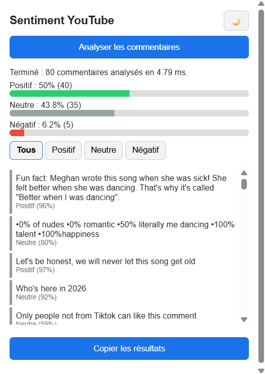
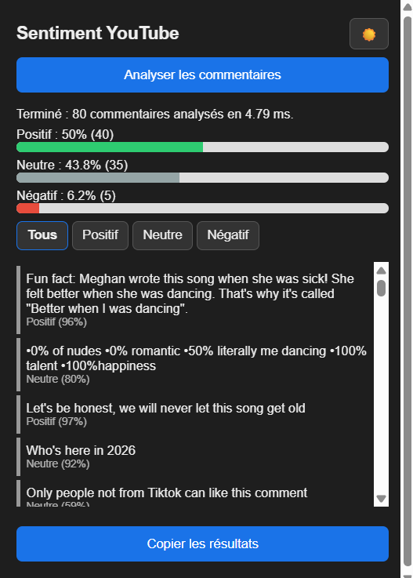

# Guide utilisateur : extension « YouTube Sentiment Analyzer »

Cette extension Chrome analyse le sentiment (positif, neutre, négatif) des commentaires de la vidéo YouTube que vous regardez.

## 1. Installation

1. Téléchargez et décompressez `extension-youtube-sentiment.zip` (ou utilisez le dossier `chrome-extension/` du dépôt).
2. Ouvrez Google Chrome et tapez `chrome://extensions` dans la barre d'adresse.
3. Activez le **Mode développeur** (interrupteur en haut à droite).
4. Cliquez sur **Charger l'extension non empaquetée** et sélectionnez le dossier de l'extension (celui qui contient `manifest.json`).
5. Épinglez l'extension : cliquez sur l'icône puzzle de Chrome, puis sur l'épingle à côté de « YouTube Sentiment Analyzer ».

> L'API doit être en marche (Codespace allumé, port 7860 public). Vérifiez en ouvrant `<URL de l'API>/health` : vous devez voir `"status":"ok"`.

## 2. Utilisation

1. Ouvrez une vidéo YouTube dont les commentaires sont de préférence **en anglais**.
2. Faites défiler la page jusqu'à la section des commentaires pour qu'ils se chargent. Seuls les commentaires affichés sont analysés (200 au maximum).
3. Cliquez sur l'icône de l'extension, puis sur **Analyser les commentaires**.
4. Le message « Terminé : N commentaires analysés en X ms » apparaît.

## 3. Lire les résultats

- **Barres de statistiques** : pourcentage et nombre de commentaires positifs, neutres et négatifs.
- **Liste des commentaires** : chaque commentaire est accompagné de son sentiment et du niveau de confiance du modèle (par exemple « Positif (96 %) »).

## 4. Fonctionnalités

| Fonction | Comment l'utiliser |
|---|---|
| Filtres | Boutons **Tous / Positif / Neutre / Négatif** au-dessus de la liste |
| Mode sombre | Bouton lune/soleil en haut à droite du popup (le choix est mémorisé) |
| Copier les résultats | Bouton **Copier les résultats** : colle ensuite le texte où vous voulez |

## 5. Messages d'erreur courants

| Message | Cause | Solution |
|---|---|---|
| « Veuillez ouvrir une page YouTube » | L'onglet actif n'est pas YouTube | Ouvrez une vidéo YouTube |
| « Impossible de communiquer avec YouTube » | La page a été ouverte avant l'installation | Actualisez l'extension puis appuyez sur F5 sur la page |
| « Aucun commentaire trouvé » | Les commentaires ne sont pas encore chargés | Faites défiler la page jusqu'aux commentaires |
| « API injoignable » ou « L'API ne répond pas » | Codespace arrêté ou conteneur éteint | Relancez le Codespace et le conteneur Docker, vérifiez que le port 7860 est public |

## 6. Limites

- Le modèle est entraîné sur des commentaires Reddit **en anglais** : les commentaires en arabe, en français ou dans d'autres langues sont peu fiables et tendent à être classés « neutre ».
- L'ironie, le spam et les commentaires très courts (horodatages, emojis seuls) peuvent être mal classés.
